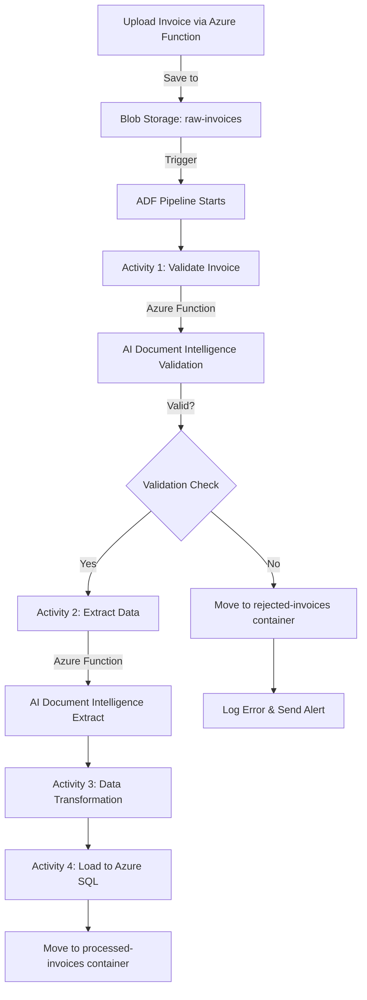

Based on your requirements, here's a **simple ETL flow for Invoice Processing** using Azure services:

## 📋 Architecture Overview

```
┌─────────────────┐
│  Invoice Upload │
│  (API/Storage)  │
└────────┬────────┘
         │
         ▼
┌─────────────────────────────────────────────────┐
│        Azure Data Factory (Orchestration)       │
│                                                  │
│  ┌──────────────────────────────────────────┐  │
│  │  Pipeline: Invoice Processing ETL        │  │
│  │                                           │  │
│  │  1. Trigger: Blob Storage Event          │  │
│  │  2. Validation Activity                  │  │
│  │  3. AI Processing Activity               │  │
│  │  4. Data Transformation                  │  │
│  │  5. Load to SQL Database                 │  │
│  └──────────────────────────────────────────┘  │
└─────────────────────────────────────────────────┘
```

## 🏗️ Detailed ETL Flow

### **Components:**

1. **Azure Function** (API Endpoint)
2. **Azure Blob Storage** (Raw invoices)
3. **Azure AI Document Intelligence** (Invoice validation & extraction)
4. **Azure Data Factory** (Orchestration)
5. **Azure SQL Database** (Structured data storage)

---

## 📝 Step-by-Step Flow

### **Step 1: Invoice Ingestion**

**Azure Function (HTTP Trigger):**
```python
import azure.functions as func
from azure.storage.blob import BlobServiceClient
import logging

def main(req: func.HttpRequest) -> func.HttpResponse:
    try:
        # Get invoice file from request
        invoice_file = req.files.get('invoice')
        
        if not invoice_file:
            return func.HttpResponse("No file provided", status_code=400)
        
        # Upload to Blob Storage
        blob_service_client = BlobServiceClient.from_connection_string(
            os.environ["STORAGE_CONNECTION_STRING"]
        )
        
        container_client = blob_service_client.get_container_client("raw-invoices")
        blob_name = f"{datetime.now().strftime('%Y%m%d_%H%M%S')}_{invoice_file.filename}"
        
        blob_client = container_client.get_blob_client(blob_name)
        blob_client.upload_blob(invoice_file.read())
        
        return func.HttpResponse(
            json.dumps({"status": "success", "blob_name": blob_name}),
            status_code=200
        )
    except Exception as e:
        logging.error(f"Error: {str(e)}")
        return func.HttpResponse("Error processing invoice", status_code=500)
```

---

### **Step 2: Azure Data Factory Pipeline**

**Pipeline Configuration:**

```json
{
  "name": "InvoiceProcessingPipeline",
  "activities": [
    {
      "name": "ValidateInvoice",
      "type": "AzureFunction",
      "description": "Validate if the file is a legitimate invoice"
    },
    {
      "name": "ExtractInvoiceData",
      "type": "AzureFunction",
      "description": "Use Azure AI Document Intelligence to extract data",
      "dependsOn": ["ValidateInvoice"]
    },
    {
      "name": "TransformData",
      "type": "DataFlow",
      "description": "Clean and transform extracted data",
      "dependsOn": ["ExtractInvoiceData"]
    },
    {
      "name": "LoadToSQL",
      "type": "Copy",
      "description": "Load to Azure SQL Database",
      "dependsOn": ["TransformData"]
    }
  ],
  "trigger": {
    "type": "BlobEventsTrigger",
    "events": ["Microsoft.Storage.BlobCreated"]
  }
}
```

---

### **Step 3: Input Validation (Azure Function)**

**Azure Function - Validation:**
```python
from azure.ai.formrecognizer import DocumentAnalysisClient
from azure.core.credentials import AzureKeyCredential
import azure.functions as func

def main(req: func.HttpRequest) -> func.HttpResponse:
    try:
        blob_url = req.params.get('blob_url')
        
        # Initialize Azure AI Document Intelligence
        document_client = DocumentAnalysisClient(
            endpoint=os.environ["FORM_RECOGNIZER_ENDPOINT"],
            credential=AzureKeyCredential(os.environ["FORM_RECOGNIZER_KEY"])
        )
        
        # Analyze document with prebuilt invoice model
        poller = document_client.begin_analyze_document_from_url(
            "prebuilt-invoice", 
            blob_url
        )
        result = poller.result()
        
        # Validation checks
        is_valid = True
        validation_errors = []
        
        if not result.documents:
            is_valid = False
            validation_errors.append("No invoice detected")
        
        # Check confidence scores
        for document in result.documents:
            if document.confidence < 0.7:
                is_valid = False
                validation_errors.append("Low confidence invoice detection")
        
        return func.HttpResponse(
            json.dumps({
                "is_valid": is_valid,
                "errors": validation_errors,
                "document_type": result.documents[0].doc_type if result.documents else None
            }),
            status_code=200
        )
    except Exception as e:
        return func.HttpResponse(
            json.dumps({"is_valid": False, "errors": [str(e)]}),
            status_code=400
        )
```

---

### **Step 4: Data Extraction (Azure Function)**

**Azure Function - Extract Invoice Data:**
```python
def main(req: func.HttpRequest) -> func.HttpResponse:
    try:
        blob_url = req.params.get('blob_url')
        
        document_client = DocumentAnalysisClient(
            endpoint=os.environ["FORM_RECOGNIZER_ENDPOINT"],
            credential=AzureKeyCredential(os.environ["FORM_RECOGNIZER_KEY"])
        )
        
        poller = document_client.begin_analyze_document_from_url(
            "prebuilt-invoice", 
            blob_url
        )
        result = poller.result()
        
        invoice_data = {
            "receiver": None,
            "cost": None,
            "date": None,
            "invoice_id": None
        }
        
        for document in result.documents:
            fields = document.fields
            
            # Extract required fields
            if "CustomerName" in fields:
                invoice_data["receiver"] = fields["CustomerName"].value
            
            if "InvoiceTotal" in fields:
                invoice_data["cost"] = fields["InvoiceTotal"].value
            
            if "InvoiceDate" in fields:
                invoice_data["date"] = fields["InvoiceDate"].value
            
            if "InvoiceId" in fields:
                invoice_data["invoice_id"] = fields["InvoiceId"].value
        
        return func.HttpResponse(
            json.dumps(invoice_data),
            status_code=200,
            mimetype="application/json"
        )
    except Exception as e:
        logging.error(f"Extraction error: {str(e)}")
        return func.HttpResponse(
            json.dumps({"error": str(e)}),
            status_code=500
        )
```

---

### **Step 5: Azure SQL Database Schema**

```sql
CREATE TABLE Invoices (
    InvoiceID INT IDENTITY(1,1) PRIMARY KEY,
    InvoiceNumber NVARCHAR(100),
    Receiver NVARCHAR(255) NOT NULL,
    Cost DECIMAL(18, 2) NOT NULL,
    InvoiceDate DATE NOT NULL,
    ProcessedDate DATETIME DEFAULT GETDATE(),
    BlobPath NVARCHAR(500),
    ValidationStatus NVARCHAR(50),
    CreatedAt DATETIME DEFAULT GETDATE()
);

CREATE INDEX IDX_InvoiceDate ON Invoices(InvoiceDate);
CREATE INDEX IDX_Receiver ON Invoices(Receiver);
```

---

### **Step 6: Data Factory Copy Activity Configuration**

```json
{
  "name": "CopyToSQL",
  "type": "Copy",
  "inputs": [
    {
      "referenceName": "ExtractedInvoiceData",
      "type": "DatasetReference"
    }
  ],
  "outputs": [
    {
      "referenceName": "AzureSQLInvoiceTable",
      "type": "DatasetReference"
    }
  ],
  "typeProperties": {
    "source": {
      "type": "JsonSource"
    },
    "sink": {
      "type": "AzureSqlSink",
      "writeBehavior": "insert",
      "sqlWriterStoredProcedureName": "sp_InsertInvoice"
    },
    "translator": {
      "type": "TabularTranslator",
      "mappings": [
        {"source": {"path": "$.receiver"}, "sink": {"name": "Receiver"}},
        {"source": {"path": "$.cost"}, "sink": {"name": "Cost"}},
        {"source": {"path": "$.date"}, "sink": {"name": "InvoiceDate"}},
        {"source": {"path": "$.invoice_id"}, "sink": {"name": "InvoiceNumber"}}
      ]
    }
  }
}
```

---

## 🔄 Complete Flow Diagram



---

## 📦 Resource Summary

| Service | Purpose |
|---------|---------|
| **Azure Function (API)** | HTTP endpoint for invoice upload |
| **Azure Function (Validation)** | Validate invoice legitimacy |
| **Azure Function (Extraction)** | Extract invoice data using AI |
| **Blob Storage** | Store raw, processed, and rejected invoices |
| **Azure AI Document Intelligence** | Invoice recognition and data extraction |
| **Azure Data Factory** | Orchestrate the ETL pipeline |
| **Azure SQL Database** | Store structured invoice data |

---

## 🚀 Deployment Steps

1. **Create Resource Group**
2. **Deploy Storage Account** with 3 containers: `raw-invoices`, `processed-invoices`, `rejected-invoices`
3. **Create Azure Function App** (Python 3.9+)
4. **Provision Azure AI Document Intelligence** service
5. **Create Azure SQL Database** with schema
6. **Deploy Azure Data Factory** with pipeline
7. **Configure Event Grid** trigger for blob storage
8. **Set up Linked Services** in ADF

---
