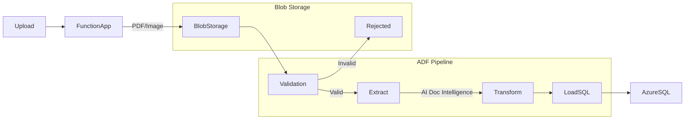

# Lab: Invoice ETL with Azure Functions, Data Factory, AI Document Intelligence and Azure SQL

## Requirements

- Active Azure subscription
- Terraform installed (>= 1.0)
- Azure CLI installed and configured
- Basic knowledge of Python and SQL

## Introduction

This lab demonstrates a complete **E**xtract **T**ransform **L**oad (ETL) pipeline for invoice processing using Azure services. The solution uses AI Document Intelligence to extract data from invoice images/PDFs, processes them through Azure Functions, orchestrates the workflow with Data Factory, and stores structured data in Azure SQL Database.

All service-to-service connections use **Managed Identity** for secure, keyless authentication.

## Architecture



## Step 1: Clone Repository and Navigate

```bash
cd /path/to/your/workspace
git clone <your-repo-url>
cd etl-2/terraform
```

## Step 2: Configure Terraform Variables

Copy the example variables file and customize it:

```bash
cp terraform.tfvars.example terraform.tfvars
```

Edit `terraform.tfvars` with your preferred text editor:

```bash
nano terraform.tfvars
```

Update the following **REQUIRED** values:

```hcl
# Resource Group and Location
resource_group_name = "rg-invoice-etl-prod"
location            = "eastus"

# Storage Account for Invoices (must be globally unique, 3-24 lowercase letters and numbers)
storage_account_name = "stinvoiceprod54321"

# AI Document Intelligence
document_intelligence_name = "doc-intel-invoice-prod"

# SQL Server (must be globally unique)
sql_server_name   = "sql-invoice-prod-54321"
sql_database_name = "InvoicesDB"

# SQL Server Admin Credentials (CHANGE THESE!)
sql_admin_username = "sqladmin"
sql_admin_password = "YourV3ryS3cur3P@ssw0rd!"

# Function App Storage (must be globally unique, 3-24 lowercase letters and numbers)
function_storage_name = "stfuncprod54321"

# Function App (must be globally unique)
function_app_name = "func-invoice-prod-54321"

# App Service Plan
app_service_plan_name = "asp-invoice-functions-prod"

# Data Factory
data_factory_name = "adf-invoice-etl-prod"
```

> **Important**: Change default passwords and ensure unique names for globally unique resources (storage accounts, SQL server, function app)!

## Step 3: Login to Azure

Login to your Azure account and set the correct subscription:

```bash
az login
az account list --output table
az account set --subscription "<your-subscription-id>"
```

Verify you're using the correct subscription:

```bash
az account show
```

## Step 4: Initialize Terraform

Initialize Terraform to download required providers:

```bash
terraform init
```

You should see output indicating successful initialization:
```
Terraform has been successfully initialized!
```

## Step 5: Review the Deployment Plan

Preview what resources will be created:

```bash
terraform plan
```

Review the output carefully. You should see:
- 1 Resource Group
- 2 Storage Accounts (invoice storage + function storage)
- 3 Blob Containers
- 1 AI Document Intelligence service
- 1 SQL Server
- 1 SQL Database
- 1 SQL Firewall Rule
- 1 App Service Plan
- 1 Linux Function App
- 1 Data Factory
- 3 Data Factory Linked Services
- 5 Role Assignments

## Step 6: Deploy Infrastructure

Deploy all resources:

```bash
terraform apply
```

Type `yes` when prompted to confirm deployment.

⏱️ **Deployment time**: Approximately 5-10 minutes

Wait for the deployment to complete. You should see:
```
Apply complete! Resources: 20 added, 0 changed, 0 destroyed.
```

## Step 7: Verify Deployment Outputs

Check the deployment outputs:

```bash
terraform output
```

You should see important information like:
- Resource group name
- Storage account name
- SQL Server FQDN
- Function App URL
- Managed Identity principal IDs

Save these values - you'll need them in the next steps!

## Step 8: Configure SQL Database Access (Managed Identity)

Now we need to grant the Function App and Data Factory access to the SQL Database using their Managed Identities.

### Option A: Using the Automated Script

Run the provided setup script:

```bash
chmod +x setup-sql-managed-identity.sh
./setup-sql-managed-identity.sh
```

The script will:
1. Extract resource names from Terraform outputs
2. Generate a SQL script with the necessary commands
3. Provide instructions for executing the SQL commands

### Option B: Manual Configuration

Get the resource names:

```bash
FUNCTION_APP_NAME=$(terraform output -raw function_app_name)
DATA_FACTORY_NAME=$(terraform output -raw data_factory_name)
SQL_SERVER=$(terraform output -raw sql_server_fqdn)
SQL_DATABASE=$(terraform output -raw sql_database_name)

echo "Function App: $FUNCTION_APP_NAME"
echo "Data Factory: $DATA_FACTORY_NAME"
echo "SQL Server: $SQL_SERVER"
echo "Database: $SQL_DATABASE"
```

Connect to the SQL Database using Azure Data Studio, SSMS, or sqlcmd:

```bash
# Using Azure CLI and sqlcmd
sqlcmd -S $SQL_SERVER -d $SQL_DATABASE -G
```

Or use Azure Portal → SQL Database → Query editor (preview)

Execute the following SQL commands:

```sql
-- Create user for Function App Managed Identity
CREATE USER [func-invoice-prod-54321] FROM EXTERNAL PROVIDER;
GO

-- Grant permissions to Function App
ALTER ROLE db_datareader ADD MEMBER [func-invoice-prod-54321];
ALTER ROLE db_datawriter ADD MEMBER [func-invoice-prod-54321];
GO

-- Create user for Data Factory Managed Identity
CREATE USER [adf-invoice-etl-prod] FROM EXTERNAL PROVIDER;
GO

-- Grant permissions to Data Factory
ALTER ROLE db_datareader ADD MEMBER [adf-invoice-etl-prod];
ALTER ROLE db_datawriter ADD MEMBER [adf-invoice-etl-prod];
GO

-- Verify the users were created
SELECT name, type_desc FROM sys.database_principals WHERE type IN ('E', 'X');
GO
```

Replace the names in brackets with your actual resource names from the output above.

## Step 9: Create Database Schema

While still connected to the SQL Database, create the Invoices table:

```sql
-- Create Invoices table
CREATE TABLE Invoices (
    InvoiceID INT IDENTITY(1,1) PRIMARY KEY,
    InvoiceNumber NVARCHAR(100),
    Receiver NVARCHAR(255) NOT NULL,
    Cost DECIMAL(18, 2) NOT NULL,
    InvoiceDate DATE NOT NULL,
    ProcessedDate DATETIME DEFAULT GETDATE(),
    BlobPath NVARCHAR(500),
    ValidationStatus NVARCHAR(50),
    CreatedAt DATETIME DEFAULT GETDATE()
);
GO

-- Create indexes for performance
CREATE INDEX IDX_InvoiceDate ON Invoices(InvoiceDate);
CREATE INDEX IDX_Receiver ON Invoices(Receiver);
GO

-- Verify table creation
SELECT * FROM INFORMATION_SCHEMA.TABLES WHERE TABLE_TYPE='BASE TABLE';
GO
```

You should see the `Invoices` table listed.

## Step 10: Deploy Function App Code

Create a simple Function App structure locally:

```bash
# Navigate to a working directory
mkdir invoice-functions
cd invoice-functions

# Create function.json for HTTP trigger
mkdir InvoiceUpload
cat > InvoiceUpload/function.json << 'EOF'
{
  "scriptFile": "__init__.py",
  "bindings": [
    {
      "authLevel": "function",
      "type": "httpTrigger",
      "direction": "in",
      "name": "req",
      "methods": ["post"]
    },
    {
      "type": "http",
      "direction": "out",
      "name": "$return"
    }
  ]
}
EOF
```

Create the function code using Managed Identity (see `function-code-examples.md` for complete examples):

```bash
cat > InvoiceUpload/__init__.py << 'EOF'
import logging
import json
import os
from datetime import datetime
import azure.functions as func
from azure.identity import DefaultAzureCredential
from azure.storage.blob import BlobServiceClient

def main(req: func.HttpRequest) -> func.HttpResponse:
    logging.info('Invoice upload function triggered')
    
    try:
        # Get invoice file from request
        invoice_file = req.files.get('invoice')
        if not invoice_file:
            return func.HttpResponse(
                json.dumps({"error": "No file provided"}),
                status_code=400,
                mimetype="application/json"
            )
        
        # Upload to Blob Storage using Managed Identity
        account_name = os.environ["STORAGE_ACCOUNT_NAME"]
        account_url = f"https://{account_name}.blob.core.windows.net"
        credential = DefaultAzureCredential()
        
        blob_service_client = BlobServiceClient(account_url, credential=credential)
        container_client = blob_service_client.get_container_client("raw-invoices")
        
        blob_name = f"{datetime.now().strftime('%Y%m%d_%H%M%S')}_{invoice_file.filename}"
        blob_client = container_client.get_blob_client(blob_name)
        blob_client.upload_blob(invoice_file.read())
        
        return func.HttpResponse(
            json.dumps({
                "status": "success",
                "blob_name": blob_name,
                "message": "Invoice uploaded successfully"
            }),
            status_code=200,
            mimetype="application/json"
        )
        
    except Exception as e:
        logging.error(f"Error: {str(e)}")
        return func.HttpResponse(
            json.dumps({"error": str(e)}),
            status_code=500,
            mimetype="application/json"
        )
EOF
```

Create `requirements.txt`:

```bash
cat > requirements.txt << 'EOF'
azure-functions
azure-identity
azure-storage-blob
azure-ai-formrecognizer
pyodbc
EOF
```

Create `host.json`:

```bash
cat > host.json << 'EOF'
{
  "version": "2.0",
  "logging": {
    "applicationInsights": {
      "samplingSettings": {
        "isEnabled": true,
        "maxTelemetryItemsPerSecond": 20
      }
    }
  },
  "extensionBundle": {
    "id": "Microsoft.Azure.Functions.ExtensionBundle",
    "version": "[4.*, 5.0.0)"
  }
}
EOF
```

Deploy the function:

```bash
# Get the function app name
FUNCTION_APP_NAME=$(cd ../terraform && terraform output -raw function_app_name)

# Deploy
func azure functionapp publish $FUNCTION_APP_NAME --python
```

Or use VS Code Azure Functions extension for deployment.

## Step 11: Test the Function App

Get the Function App URL:

```bash
cd ../terraform
FUNCTION_URL=$(terraform output -raw function_app_url)
echo "Function App URL: $FUNCTION_URL"
```

Test the upload endpoint using curl:

```bash
# Get the function key
FUNCTION_KEY=$(az functionapp keys list \
  --name $FUNCTION_APP_NAME \
  --resource-group $(terraform output -raw resource_group_name) \
  --query functionKeys.default -o tsv)

# Upload a test invoice (replace with your actual invoice file)
curl -X POST "$FUNCTION_URL/api/InvoiceUpload?code=$FUNCTION_KEY" \
  -F "invoice=@/path/to/test-invoice.pdf" \
  -H "Content-Type: multipart/form-data"
```

You should receive a JSON response with status "success".

## Step 12: Verify Blob Upload

Navigate to Azure Portal → Storage Account → Containers → `raw-invoices`

You should see your uploaded invoice file with a timestamp in the name.

> Note: You may need to wait a few minutes for the file to appear and for proper permissions to propagate.

## Step 13: Configure Data Factory Pipeline

Open Azure Portal and navigate to your Data Factory, then click "Launch Studio".

### Create Pipeline:

1. From left menu, select "Author" (pencil icon)
2. Click "+" → "Pipeline"
3. Name it "InvoiceProcessingPipeline"

### Add Activities:

From "Move & transform" section, drag these activities to the canvas:

1. **Copy Data** activity
   - Name: "LoadInvoiceData"
   - Source: JSON dataset (blob storage)
   - Sink: Azure SQL dataset (Invoices table)

2. Configure the Copy Data activity:
   - **Source tab**: Select the blob container and path pattern
   - **Sink tab**: Select the SQL database and Invoices table
   - **Mapping tab**: Import schemas and map fields

### Create Datasets:

**For Blob (Source):**
- Navigate to "Author" → "Datasets" → "New dataset"
- Select "Azure Blob Storage"
- Choose "JSON" format
- Link to "BlobStorageLinkedService"
- Browse to select a sample file from `raw-invoices`

**For SQL (Sink):**
- Navigate to "Author" → "Datasets" → "New dataset"
- Select "Azure SQL Database"
- Link to "SqlDatabaseLinkedService"
- Select table: `dbo.Invoices`
- Import schema

### Add Trigger:

1. Click "Add trigger" → "New/Edit"
2. Select "Storage events"
3. Configure to trigger on blob creation in `raw-invoices` container

### Test the Pipeline:

1. Click "Debug" to test run
2. Wait for completion
3. Check the output

## Step 14: Verify End-to-End Flow

Test the complete ETL pipeline:

1. **Upload an invoice** through the Function App
2. **Check blob storage** - file appears in `raw-invoices`
3. **Monitor Data Factory** - pipeline runs automatically
4. **Query SQL Database**:

```sql
SELECT * FROM dbo.Invoices
ORDER BY CreatedAt DESC;
```

You should see your invoice data in the database!

## Step 15: Publish Data Factory Changes

Once everything works correctly:

1. Click "Publish all" in Data Factory Studio
2. Confirm changes
3. Wait for deployment

Your pipeline is now live!

## Step 16: Monitor and Maintain

### View Function Logs:

```bash
az functionapp logs tail \
  --name $FUNCTION_APP_NAME \
  --resource-group $(terraform output -raw resource_group_name)
```

### Monitor Data Factory:

Azure Portal → Data Factory → Monitor → Pipeline runs

### Query Invoices:

```sql
-- Count total invoices
SELECT COUNT(*) as TotalInvoices FROM dbo.Invoices;

-- View recent invoices
SELECT TOP 10 * FROM dbo.Invoices ORDER BY CreatedAt DESC;

-- Invoices by validation status
SELECT ValidationStatus, COUNT(*) as Count 
FROM dbo.Invoices 
GROUP BY ValidationStatus;
```

## Troubleshooting

### Issue: Function App cannot access storage

**Solution**: Verify role assignments
```bash
FUNCTION_PRINCIPAL=$(terraform output -raw function_app_principal_id)
az role assignment list --assignee $FUNCTION_PRINCIPAL
```

### Issue: Data Factory cannot connect to SQL

**Solution**: Check managed identity SQL user
```sql
SELECT name, type_desc FROM sys.database_principals 
WHERE name = 'adf-invoice-etl-prod';
```

### Issue: AI Document Intelligence returns errors

**Solution**: Verify role assignment
```bash
ADF_PRINCIPAL=$(terraform output -raw data_factory_principal_id)
az role assignment list --assignee $ADF_PRINCIPAL
```

### Issue: Terraform deployment fails

**Solution**: Check for name conflicts
- Storage account names must be globally unique
- SQL Server names must be globally unique
- Function App names must be globally unique

Try adding random numbers or your initials to make names unique.

## Clean Up

To destroy all resources and avoid charges:

```bash
cd terraform
terraform destroy
```

Type `yes` when prompted.

**Warning**: This will permanently delete all resources including data!

## Additional Resources

- [MANAGED-IDENTITY.md](terraform/MANAGED-IDENTITY.md) - Complete Managed Identity documentation
- [function-code-examples.md](terraform/function-code-examples.md) - Python code samples
- [post-deployment-setup.md](terraform/post-deployment-setup.md) - Detailed post-deployment steps
- [Azure Terraform Provider](https://registry.terraform.io/providers/hashicorp/azurerm/latest/docs)
- [Azure Functions Python Developer Guide](https://docs.microsoft.com/azure/azure-functions/functions-reference-python)
- [Azure Data Factory Documentation](https://docs.microsoft.com/azure/data-factory/)
- [Azure AI Document Intelligence](https://docs.microsoft.com/azure/applied-ai-services/form-recognizer/)

## Cost Estimation

Approximate monthly costs (East US, Basic tier):
- Storage Accounts: ~$1-5
- AI Document Intelligence (S0): ~$1.50 per 1000 pages
- SQL Database (Basic): ~$5
- Function App (Consumption): Pay per execution (~$0.20 per million executions)
- Data Factory: Pay per activity run (~$0.50 per 1000 runs)

**Total estimated**: $10-50/month for development/testing

For production workloads, consider upgrading to higher tiers.
