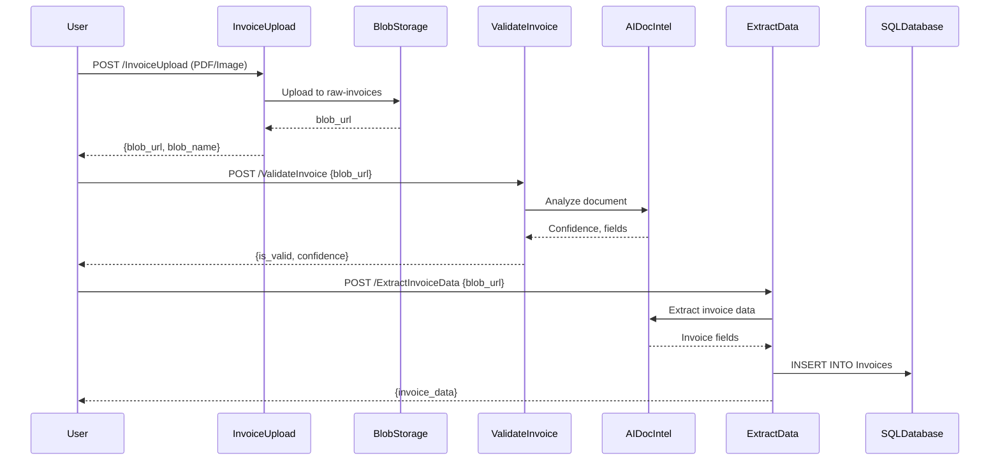

# Invoice ETL - Project Overview

## 📋 Complete Project Structure

```
etl-2/
├── 📂 functions/                      # Azure Functions Application
│   ├── InvoiceUpload/                # HTTP trigger - Upload invoices
│   │   ├── __init__.py              # Upload logic with Managed Identity
│   │   └── function.json            # Function configuration
│   ├── ValidateInvoice/             # HTTP trigger - Validate invoices
│   │   ├── __init__.py              # AI validation logic
│   │   └── function.json            # Function configuration
│   ├── ExtractInvoiceData/          # HTTP trigger - Extract and save data
│   │   ├── __init__.py              # AI extraction + SQL save
│   │   └── function.json            # Function configuration
│   ├── requirements.txt             # Python dependencies
│   ├── host.json                    # Function app settings
│   ├── .funcignore                  # Deployment exclusions
│   ├── local.settings.json.example  # Local dev configuration
│   └── README.md                    # Functions documentation
│
├── 📂 terraform/                      # Infrastructure as Code
│   ├── main.tf                      # Resources (Storage, SQL, Functions, ADF, AI)
│   ├── variables.tf                 # Input variables
│   ├── outputs.tf                   # Output values
│   ├── providers.tf                 # Azure provider config
│   ├── terraform.tfvars.example     # Example configuration
│   ├── README.md                    # Terraform documentation
│   ├── MANAGED-IDENTITY.md          # Security architecture
│   ├── function-code-examples.md    # Code samples
│   ├── post-deployment-setup.md     # SQL setup guide
│   └── setup-sql-managed-identity.sh # SQL automation script
│
├── 📜 Deployment Scripts
│   ├── deploy-all.sh                # Complete deployment automation
│   ├── deploy-functions.sh          # Deploy functions only
│   ├── test-functions.sh            # Test deployed functions
│   └── cleanup.sh                   # Destroy all resources
│
└── 📖 Documentation
    ├── QUICK-START.md               # Quick reference guide
    ├── DEPLOYMENT-GUIDE.md          # Detailed deployment steps
    └── 2.md                         # Original architecture design
```

## 🏗️ Azure Resources Created

### Compute & Functions
- **Azure Function App** (Linux, Python 3.9, Consumption Plan)
  - System-assigned Managed Identity
  - 3 HTTP-triggered functions
  - Automatic scaling

### Storage
- **Invoice Storage Account**
  - `raw-invoices` container
  - `processed-invoices` container
  - `rejected-invoices` container
- **Function App Storage** (internal)

### AI & Data
- **AI Document Intelligence** (Form Recognizer S0)
  - Prebuilt invoice model
- **Azure SQL Database** (Basic tier)
  - Invoices table with indexes
- **Azure Data Factory**
  - Linked services (Blob, SQL, Functions)
  - Ready for pipeline configuration

### Security
- **Managed Identities** (System-assigned)
  - Function App identity
  - Data Factory identity
- **Role Assignments**
  - Storage Blob Data Contributor
  - Cognitive Services User
  - SQL database roles

## 🔐 Security Architecture

All connections use **Managed Identity** - NO keys or passwords in code:

```
┌─────────────────┐
│  Function App   │──┐
│ (Managed ID)    │  │ Storage Blob Data Contributor
└─────────────────┘  ├──► Invoice Storage Account
                     │
                     │ Cognitive Services User
                     ├──► AI Document Intelligence
                     │
                     │ db_datareader, db_datawriter
                     └──► Azure SQL Database

┌─────────────────┐
│  Data Factory   │──┐
│ (Managed ID)    │  │ Storage Blob Data Contributor
└─────────────────┘  ├──► Invoice Storage Account
                     │
                     │ Cognitive Services User
                     ├──► AI Document Intelligence
                     │
                     │ db_datareader, db_datawriter
                     └──► Azure SQL Database
```

## 🔄 Invoice Processing Flow



## 🚀 Deployment Commands

### Complete Deployment
```bash
./deploy-all.sh
```

### Individual Steps
```bash
# 1. Infrastructure
cd terraform
terraform init
terraform apply

# 2. SQL Setup
./setup-sql-managed-identity.sh
# Execute generated SQL script

# 3. Functions
cd ..
./deploy-functions.sh

# 4. Test
./test-functions.sh
```

### Cleanup
```bash
./cleanup.sh
```

## 📊 Cost Estimate (USD/month)

| Service | Tier | Estimated Cost |
|---------|------|---------------|
| Function App | Consumption (Y1) | $0-10 (pay-per-execution) |
| Storage Account x2 | Standard LRS | $1-5 |
| AI Document Intelligence | S0 | $1.50 per 1000 pages |
| SQL Database | Basic | $5 |
| Data Factory | Pay-per-run | $0.50 per 1000 runs |
| **Total** | | **$10-50/month** |

*Development/testing estimate. Production costs vary by usage.*

## 🧪 Testing

### Automated Testing
```bash
./test-functions.sh
```

### Manual Testing
```bash
# Upload invoice
curl -X POST "https://your-function.azurewebsites.net/api/InvoiceUpload?code=XXX" \
  -F "invoice=@invoice.pdf"

# Validate invoice
curl -X POST "https://your-function.azurewebsites.net/api/ValidateInvoice?code=XXX" \
  -H "Content-Type: application/json" \
  -d '{"blob_url": "https://..."}'

# Extract data
curl -X POST "https://your-function.azurewebsites.net/api/ExtractInvoiceData?code=XXX" \
  -H "Content-Type: application/json" \
  -d '{"blob_url": "https://...", "blob_name": "invoice.pdf"}'
```

### Query Results
```sql
SELECT * FROM Invoices ORDER BY CreatedAt DESC;
```

## 📖 Documentation Files

| File | Purpose |
|------|---------|
| `QUICK-START.md` | Fast reference for common tasks |
| `DEPLOYMENT-GUIDE.md` | Step-by-step deployment walkthrough |
| `terraform/README.md` | Terraform infrastructure details |
| `terraform/MANAGED-IDENTITY.md` | Security and authentication |
| `functions/README.md` | Function app development guide |
| `2.md` | Original architecture specification |

## 🔧 Troubleshooting

### Functions can't connect
```bash
# Check role assignments
az role assignment list --assignee $(cd terraform && terraform output -raw function_app_principal_id)
```

### SQL access denied
```sql
-- Verify managed identity users
SELECT name, type_desc FROM sys.database_principals WHERE type = 'E';
```

### View logs
```bash
az functionapp log tail \
  --name $(cd terraform && terraform output -raw function_app_name) \
  --resource-group $(cd terraform && terraform output -raw resource_group_name)
```

## 🎯 Next Steps

After deployment:

1. ✅ Configure Data Factory pipeline with activities
2. ✅ Set up blob event triggers for automation
3. ✅ Configure monitoring and alerts
4. ✅ Test end-to-end invoice processing
5. ✅ Implement error handling and retry logic
6. ✅ Add more invoice validation rules
7. ✅ Configure CI/CD pipeline for functions

## 📞 Support

For issues or questions:
- Check troubleshooting section in DEPLOYMENT-GUIDE.md
- Review Azure Function logs
- Verify Managed Identity role assignments
- Check SQL database connectivity

## 📄 License

This project demonstrates Azure serverless ETL patterns with Managed Identity authentication.
